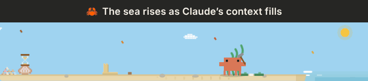
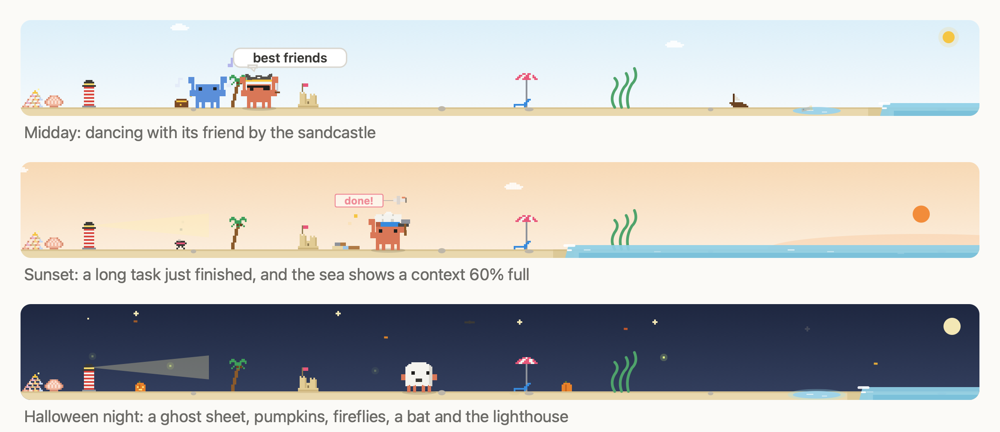

# crab-buddy 🦀

**See what Claude is doing without reading the transcript.** A sea that rises with your context, a red flag when Claude is waiting for you, an hourglass for your usage limit, a ready `/compact` at the right moment. All of it shown by a tiny pixel crab with a life of its own, on a beach above your prompt.

Unofficial, not affiliated with Anthropic.





<sub>Drawn by the mod's own code; in Claude Code it moves.</sub>

## What it does

What it shows you:

- **Your context.** The sea creeps up the beach as the context fills, toward where Claude really compacts.
- **When Claude needs you.** It holds up a red flag while Claude waits for a permission, an answer or a plan, and offers a ready `/compact` at the right moment.
- **Your usage limit.** An hourglass by its shell fills as the limit or budget runs down.
- **What Claude is doing.** A hammer for edits, a scroll for reading, binoculars for the web, a fishing rod for every subagent. Commits get fireworks, failing tests a storm cloud, long tasks a "done!" plane and a chirp.
- **The news.** Task done, commit pushed, PR merged: it stops, faces you and raises a sign.
- **The state of your work, kept.** A logbook of files, tests and commits that goes to the summary when the context gets compacted.

And the crab itself:

- **Lives its own life.** It strolls, digs, builds a sandcastle, collects shells, chases butterflies, and now and then turns to look at you.
- **Has a real sky.** Sunrise and sunset, the actual moon phase, seasons, holidays and, if you like, your local weather.
- **Looks after you, and wants looking after.** It nudges you to take a break after a long stretch. Feed it, play with it, pet it; it remembers you across sessions.
- **Goes between your windows, if you like.** One crab for all your sessions: it follows you and runs to a window that finishes.

A new costume every day, a new beach to match. The animation is all CSS and costs no tokens.

## Install

Type this at the Claude Code prompt:

```
/plugin install crab-buddy --marketplace donalfredo2/crab-buddy
```

Answer `y` to add the marketplace, pick a scope, and the crab appears in your next session. It needs a recent Claude Code (2.1.309 or later). The desktop app shows the full beach; the terminal draws it in coloured blocks.

## Updates

New versions are published here with a higher version number. To get the latest:

```
/plugin marketplace update crab-buddy
/plugin update crab-buddy@crab-buddy
```

Then start a new session. To get updates automatically, open `/plugin`, go to Marketplaces, pick `crab-buddy` and turn on auto-update: Claude Code then checks for a new version when it starts.

## The strip

The crab has a little beach: sand with its home shell, a pile of the shells it has found, its sandcastle, a pebble, swaying seaweed, a tide pool and the sea at the right end. Everything above the sand is transparent. On the desktop and in VS Code the beach fills the row up to its buttons and follows the window as you resize it.

**The tank:** `/crab tank` moves the whole beach into a pane of its own, drawn twice as big with a tall sky above it, the care buttons underneath and nothing left above the prompt. Docked beside the chat it is nearly square. `/crab strip`, or closing the pane, brings it back. The choice is kept across sessions; if the app can't show the pane, the crab stays above the prompt.

- **Sky:** a sun by day, a sunset glow from 18:00, drifting clouds, and at night stars, shooting stars and the moon in its real phase. Fireflies come out on warm nights and the tide pool glows.
- **Seasons and holidays:** leaves blow by in autumn and snow lies in winter. On Halloween it wears a ghost sheet among pumpkins and a bat, at Christmas a Santa hat beside a tiny tree, and at New Year there are fireworks.
- **Weather:** with a place set, or `auto` to follow where you are (see Settings), the real local weather shows: rain (it carries a tiny umbrella), snow, storms with the odd flash, fog, and wind that bends the seaweed.
- **The sea shows your context:** the shoreline creeps up the beach as the context fills, to just past the castle at the point Claude compacts, with a small tide on top. See [The tide](#the-tide).
- **Each costume has its beach:** a treasure chest and shipwreck for the pirate, craters and the Earth for the astronaut, a BBQ for the chef, cones and a crane for the engineer, a surfboard and beach ball for the surfer, fins and a buoy for the diver, a longship for the viking, a tower for the wizard, speakers and decks for the DJ, a beer table and flags for Oktoberfest, a finish flag for the racer, a magnifier and question marks for the detective.
- **Each costume has its gadget:** every so often it takes it out, about every 11 minutes, and `/crab ride` sends it off right away. A low sports car for the racer (headlights on after dark), a longship for the viking, a digger for the engineer, a food cart for the chef, a skateboard when it's plain, a newspaper to hide behind for the detective, a barrel to balance on at Oktoberfest, a paper boat in the rain, a sedan chair carried by two friends for the king, a broom for the wizard, a sleigh for Santa, a pumpkin lantern for the ghost, a rocket for the astronaut, a wave for the surfer, a mini-sub for the diver, decks and a disco ball for the DJ, a cannon for the pirate.
- **Shells unlock decor, your beach's own:** at 5 a palm, a plastic flamingo or a lifebuoy on a post. At 10 something to sunbathe in: a deck chair, a Strandkorb, a hammock or, on the odd beach, an armchair with a lamp and a rug. At 20 a shelter that lights up after dark: a little house, a lifeguard tower, a beach hut or, on the odd beach, a vending machine. At 40 a rowing boat, a sailing dinghy or, on the odd beach, a swan pedal boat, which floats when the tide reaches it. Whatever you had earned before 0.19.0 stays as it was. Very rarely it finds a golden shell.
- **No two beaches quite alike:** your decor, pebble, seaweed and tide pool each lie somewhere of their own, your palm leans its own way and your house, umbrella and boat have their own colours. Your crab has its own ways too, so one digs more and another watches the sky; `/crab stats` names it in a word. It's all worked out from the date you first met, on your machine, and stays the same in all your windows.

Its costume changes every day (astronaut, surfer, detective, viking, engineer, diver, chef, wizard, racer, DJ, pirate, plain), and holidays win. In rain or a storm it puts on a raincoat, if you've set `weatherPlace`. From 20-09 to 05-10 it's Oktoberfest, and 50 shells earn the crown: `/crab king`. A costume you pick beats a holiday, a holiday beats the rain, and the rain beats the day's costume. Your first message of the day gets a hello that names the theme ("ahoy, it's pirate day!"), and `/crab theme` tells you any time. While a savvy-progress bar is showing, the crab steps aside so there is only one crab on screen.

## A life of its own

The crab plans its own day, a couple of minutes at a time, and strolls between things it wants to do. Every 20 to 40 seconds it gets up to something:

- **Around the beach:** digs in the sand, kicks the pebble, checks or hides in its shell, sways with the seaweed, sunbathes.
- **Visitors:** chases a butterfly, ducks from a seagull, watches a fish jump, says hi to the hermit-crab neighbour, and now and then a blue friend crab comes over to dance, race or watch the sky together.
- **Self-aware moments:** turns and looks at you (sometimes with a wink), peeks at the buttons, and now and then wonders out loud whether it is made of pixels. When you send a message it stops, a "!" pops up, and it turns to you.
- **Quirks:** yawns, sneezes, hiccups, watches the sky, dances.
- **Traces:** it builds its sandcastle a stage at a time (the tide clears it overnight), carries shells it finds home to a pile that grows over days, and leaves footprints that fade.

Its needs steer the odds: hungry, it digs more; bored, it kicks pebbles; tired, it yawns and naps sooner; happy, it dances. After 10 quiet minutes, or at night, it walks home and sleeps.

While Claude works it is a bit busier and mirrors the tool in use: a scroll for reading, a magnifier for searching, a hammer for edits, a tiny keyboard for shell commands, binoculars for the web, and a fishing rod for subagents. Every tool call adds a block to a work pile by the castle, which it tidies away after the turn.

Big moments take the whole strip: fireworks for a commit, a storm cloud over the crab for failing tests, and a plane with a "done!" banner after a long task.

## A pet with needs

Three meters, kept across sessions, never below 10, and it never dies:

- **Food**: every finished turn +3, the 🍤 button +15 (5-minute cooldown). Hungry below 30: a thought bubble with a shrimp.
- **Fun**: commits +10, passing tests +5, ✋ pet +5, 🎾 play +15.
- **Energy**: drains while you work (twice as fast after 23:00), refills with a 15-minute break (+40) or a night away (full). Low energy makes it sleepy.

Food and Fun fade 5 points an hour, counted only while a session is open. When the lowest meter drops under 25 it gets grumpy.

## What it tells you

- **Long task done**: a turn of 2 minutes or more ends with a wave, a sign, a toast and a short chirp.
- **Context filling up**: half-lidded and slower past the mark, sweating near the top, and a sign in the sand just before Claude would compact.
- **Commits, tests, builds**: confetti, sunglasses, or a nervous shiver. Results are never changed.
- **Breaks**: after 90 minutes of continuous work it stretches and holds up a coffee sign, and twice that earns a walk; Snooze adds 30 minutes.
- **Speech bubbles**: short canned lines at moments that matter, at most one unprompted line every 15 minutes (`rare`) or 5 (`often`). Your own care actions always get a reply.

## Lending a claw

Three small helps, all free: nothing goes to the model, and the crab never answers, blocks or changes anything for you.

- **The red flag:** when Claude is waiting for you (a permission, a question, a plan to approve) the crab turns to you and holds up a red flag saying what for: "needs you: Bash", "a question for you", "a plan to approve", "a helper needs you" for a subagent. It comes down when you answer, write, or the turn ends. It makes no sound: Claude Code already notifies you its own way. News that comes meanwhile waits behind it. With roaming on, the crab goes to the window that waits, once you've been quiet a minute; until then its sign says "<repo> needs you". `/crab needs off` turns it off.
- **A ready /compact:** at the good moment sign, or with the sea near the top, a `/compact` waits dim in the empty prompt box, telling the summary what to keep: the files you worked on, the last commit, and a test or build left failing. Tab takes it, Enter sends it; ignore it and it goes. Once per fill of the context. `/crab tips off` turns it off.
- **The hourglass:** on a subscription a small hourglass stands on the crab's home shell. Its top holds what's left of your five-hour usage limit; the sand runs down as you use it, red from 95%. At 80% and 95% a sign goes up in the sand with when it runs out at this pace and when it resets ("limit 81% · full ~15:40 · resets 16:20"), once each per window. On API billing it counts a budget instead, if you set `budgetUsd`. `/crab stats` says it in words. `/crab hourglass off` turns it off.

## The logbook

The crab logs the session's work as it happens: files changed since the last commit, including by subagents, the last test and build results, and recent commits. Keeping the log costs nothing. `/crab log` shows it.

- **The bottle:** before each compaction the log goes to the summarizer, as a note of up to 600 characters asking it to keep those facts. The note says it is recorded data, not instructions, and its lines sit in a `<crab-log>` block that nothing logged can close, because commit titles and file names are written by whoever made them. A bottle then washes up at the waterline. This is the one thing the mod adds to what Claude reads, so it costs a few tokens and it's disclosed here. It's on by default, and `/crab log off` turns it off. The summarizer can still leave things out, so it improves the odds and guarantees nothing.
- **The good moment sign:** when a turn ends on a commit or passing tests with the tide past the mark, the crab plants a sign. The work is at a clean break, so it's a good moment to `/compact`. It shows once, and again once the sea has gone well back and come in again. A ready `/compact` waits in the prompt box with it: see [Lending a claw](#lending-a-claw).

## The tide

The sea measures against where Claude really compacts, read from Claude Code itself, not a fixed percentage. On a large context window two lines matter:

- **The top of the beach** is where Claude compacts on its own, close to the end of the window.
- **The mark**, a line of seaweed and shell on the sand, sits at 200k tokens. Claude Code compacts a conversation that size or bigger once it has been idle for about 54 minutes, before its prompt cache expires. So past the mark, a long break can bring a compaction with it.

The way to the mark takes up half the beach, because that's where most long sessions spend their time. Once the sea passes it, the mark still shows through the water.

A compaction takes the sea back at once. Claude Code reports no size until its next reply, so until then the sea stands on a count made on your machine, which sends nothing.

To pick the moment yourself, `/compact` at the good moment sign before you step away. To turn idle compaction off, set `"idleCompaction": false` in your Claude Code settings; the mark goes too, from your next session. Without it, coming back after an hour makes Claude re-read the whole conversation, which costs more of your usage. `CLAUDE_CODE_IDLE_COMPACT_MIN_TOKENS` moves the minimum, and the mark follows it.

The mark only shows on a subscription: that's the crab's stand-in for the one-hour cache idle compaction needs, so it can be wrong. Without one, or with a small context window, the sea runs in a straight line to the top.

## One crab, many beaches

Off by default. `/crab roam on` gives all your open sessions one crab between them, and your other sessions join within a minute. `/crab roam off` gives every window its own again.

It's wherever you last wrote. Write in another window and it wades into the sea, sinks, and rises out of the sea over there. When a long task finishes in a window you aren't using, it goes there, so an empty beach beside you means something is done. If you wrote in the last minute it stays with you and holds up a sign saying which one finished, and goes once you pause.

A beach without the crab keeps its own sea, sky and fishing rods, its fireworks still go off, and a sign in the sand says where the crab went. Pressing a care button there calls it over, as does `/crab here`. `/crab where` tells you where it is. A window that hides the crab, or that a savvy-progress bar has taken over, can't have it.

Each session writes a small file to `crab-buddy/beaches/` in your Claude folder every 3 seconds, holding when it was last seen, the repo's folder name and when you last wrote there. Nothing leaves your machine. The files stay after roaming is off; delete the folder to remove them. With roaming off, or a single window open, nothing changes.

## Fishing

Each running subagent is a rod at the water's edge with a float bobbing in the sea, so you can see at a glance what's still out. The rods move with the tide, and three are drawn at most.

When one finishes the crab hurries over and reels it in: a fish, and a sign saying how many are still out. A subagent that failed or was stopped brings up an old boot. `/crab lines` lists what's out, and `/crab stats` keeps the tally.

Teammates that idle between turns get no rod, nor do a workflow's agents, which aren't listed for mods. While a savvy-progress bar is up the strip steps aside, so rods only show in the tank.

## Signs

News goes on a plank, one sign at a time, about 7 seconds each. Bubbles are the crab chatting; signs are for you.

- **Held up:** task done, with how long it took. Committed, pushed, PR or MR opened, merged. Green again, when tests pass after a failure. Plain test passes get no sign.
- **Coffee, then a walk:** held up from home while the break is due.
- **Planted in the sand:** the good moment to `/compact`, and the sea nearly at the top. They stay up for a while, and the crab carries on.

Signs wait in line if several arrive together, and your message clears the line. Your care actions always get their answer. It sees `git`, `gh` and `glab` commands, and connected tools that create or merge a PR or MR. `/crab signs off` goes back to bubbles and toasts; `/crab bubbles off` leaves signs on.

## Buttons and commands

Beside the strip (or under the tank): 🍤 feed, 🎾 play, ✋ pet.

- `/crab feed`, `/crab play`, `/crab pet`
- `/crab ride`: sends it off on its gadget right now
- `/crab name <name>`: give it a name (up to 16 characters)
- `/crab stats`: session time, turns, tool calls, context, usage limit or budget, needs, shells, fish, what kind of crab it is and today's theme
- `/crab lines`: the subagents out fishing
- `/crab log`: what's in the logbook; `/crab log on|off` turns the bottle on or off
- `/crab theme`: today's theme, and the costume you picked if it differs
- `/crab weather`: which place the weather is for, how it was found, and what it is
- `/crab size`: what this surface reports for the strip, handy if it looks stretched
- `/crab bubbles often|rare|off`, `/crab signs on|off`, `/crab breaks on|off`, `/crab sound on|off`
- `/crab needs on|off`, `/crab tips on|off`, `/crab hourglass on|off`: the red flag, the ready /compact, the hourglass
- `/crab snooze`: snooze the break reminder for 30 minutes
- `/crab`, `/crab <costume>`, `/crab today`: costumes
- `/crab tank` / `/crab strip`: move it into its tank pane or back above the prompt; `/crab tank` again says where the pane sits
- `/crab roam on|off`: one crab across your windows, or one each
- `/crab where`, `/crab here`: where it is, and calling it over
- `/crab off` / `/crab on`: hide or show it
- `/crab restart`: hide it for 35 seconds so VS Code draws it afresh, for when it drops to a frame a second after the window has been in the background

## Settings

`longTaskSeconds` (120), `breakMinutes` (90), `budgetUsd` (0), `sound` (`on`), `bubbles` (`rare`), `signs` (`on`) and `weatherPlace` (empty) can be changed with `/plugin configure crab-buddy@crab-buddy`; 0 turns a timer off.

`budgetUsd` is for API billing: the hourglass counts the session's cost against it. Left at 0 there is no hourglass on API billing; a subscription's usage limit needs no setting.

`weatherPlace` says whose weather shows, and nothing is fetched unless you set it:

- **Empty** (the default): nothing is fetched and the sky stays clear.
- **A city name**, like `Lisbon`: the place's name and coordinates go to [Open-Meteo](https://open-meteo.com) (free, no key) once an hour, shared by all open sessions. A place you type always wins.
- **`auto`** (recommended): the weather where you are, from your system time zone's city (`Europe/Berlin` is Berlin, `America/New_York` is New York). Only that city's name and coordinates go to Open-Meteo, the same as typing it; nothing new leaves your machine. It's coarse: the zone names one city for a whole region.
- **`auto-ip`**: the weather where you are, by IP address, from [ipwho.is](https://ipwho.is) (free, no key), which sees your IP. Accurate to the city, unless you're on a VPN. If the lookup fails it falls back to the time zone's city, which then goes to Open-Meteo as with `auto`.

The place `auto-ip` or `auto` finds is looked up again after 3 hours (at once if your time zone changes), so a laptop that travels catches up, and is shared by all open sessions. The weather itself refreshes hourly. Offline, the last place and weather stay. A service that doesn't answer within 10 seconds, or fails, is left alone for 15 minutes by every session. `/crab weather` says which place it is and how it was found.

## Privacy

What goes out, and only when you set `weatherPlace`:

| To | What | When |
|---|---|---|
| [Open-Meteo](https://open-meteo.com) | a city name (yours, or your time zone's), then coordinates rounded to about 1 km | once per place, then hourly for the weather |
| [ipwho.is](https://ipwho.is), `auto-ip` only | the request itself, so your IP address | every 3 hours |

Nothing else leaves your machine. What stays on it:

- **In Claude Code's plugin store:** your crab (name, needs, shells, castle, fish, decor), your `/crab` choices, and with weather on, the place found, its coordinates (to about 1 km, never your IP) and the last weather. Emptying `weatherPlace`, or changing it, wipes the place and weather it had found.
- **In the session only:** the logbook (file paths, test and build results, commit titles), which goes to the summarizer as described in [The logbook](#the-logbook). `/clear` empties it, and `/crab log off` keeps it out of the summary.
- **On disk, with roaming on:** a small file per window in `crab-buddy/beaches/` in your Claude folder (see [One crab, many beaches](#one-crab-many-beaches)). These files aren't deleted when you turn roaming off or uninstall: delete the folder to remove them.

## In the terminal

The terminal draws no pictures, so there the beach is coloured half-block characters: three rows above the prompt with the buttons beside it, and a taller beach in the tank when the terminal docks panes (fullscreen). The same life plan drives it, so the crab does what it does on the desktop: walks, naps, builds its castle, watches the sea creep in with your context, and talks beside its head. The decor your shells unlock shows from about 63 columns, and the house from about 80. Empty cells keep your terminal's own colours. It is repainted four times a second (once a second while it naps) only while it is on screen. It needs Claude Code 2.1.309 or later; `claude update` gets you there.

On the desktop and in VS Code the animation is CSS only, costs no tokens, and stops when macOS "Reduce motion" is on. The chirp is an original sound synthesized for this mod.

## Development

Three checks, the same ones CI runs on every push and pull request:

```
claude plugin validate .          # the manifests
claude plugin test .              # every *.test.tsx, through the real mod
bun scripts/check-animations.ts   # the beach in a real browser (needs playwright and Chromium)
```

`CRAB_SHOTS=/tmp/crab` also saves a PNG per animation scenario, and `CRAB_ONLY=<name>` runs just one.

`bun scripts/make-demo.ts` redraws `docs/demo.gif` (it also needs ffmpeg) and `bun scripts/make-icon.ts` the icon. Every version bump adds an entry to `CHANGELOG.md`.

## Credits

The crab sprite and costumes are adapted from [savvy-progress](https://github.com/johnnyvizz/claude-kit/tree/main/plugins/savvy-progress) by johnnyvizz, MIT License, Copyright (c) 2026 johnnyvizz.

## License

MIT, see `LICENSE`. The crab sprite credit above applies to the adapted artwork.
